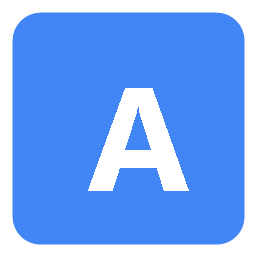
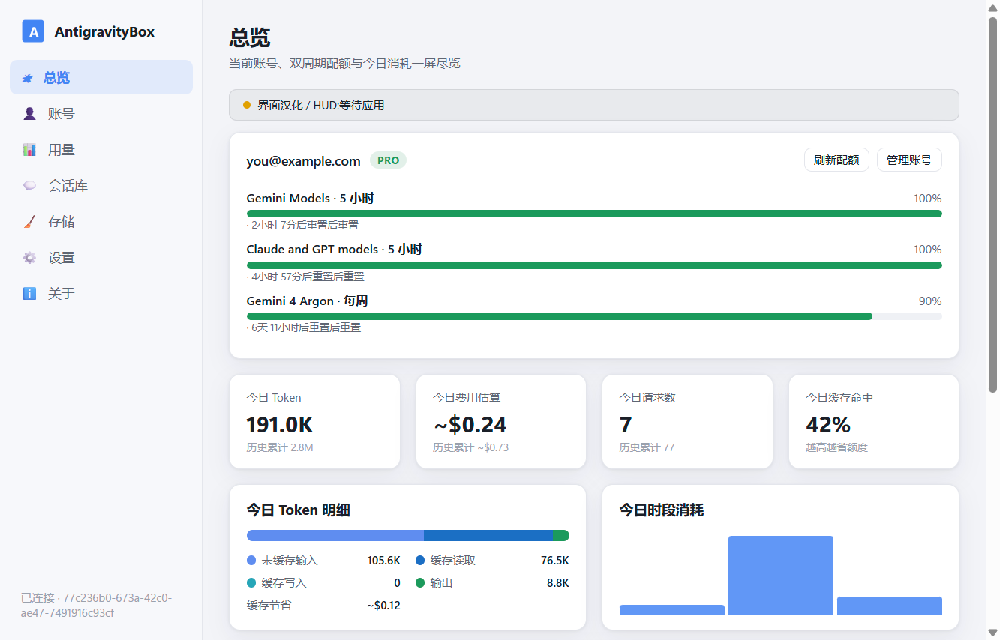
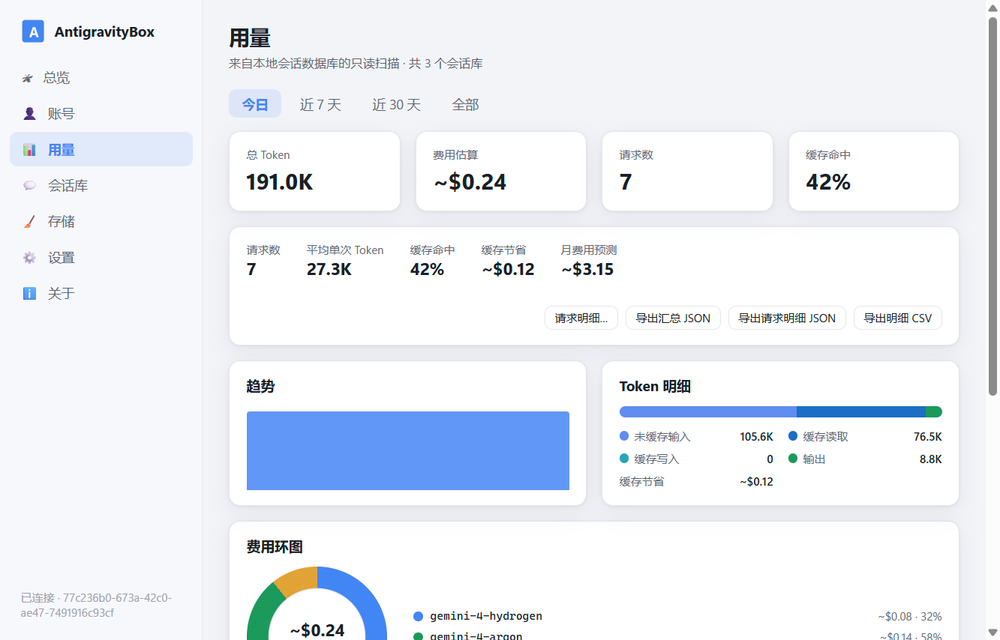
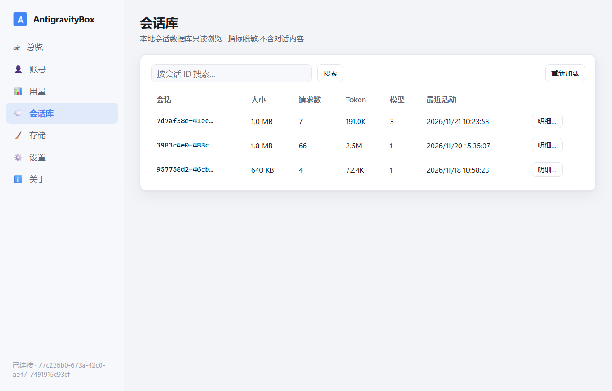
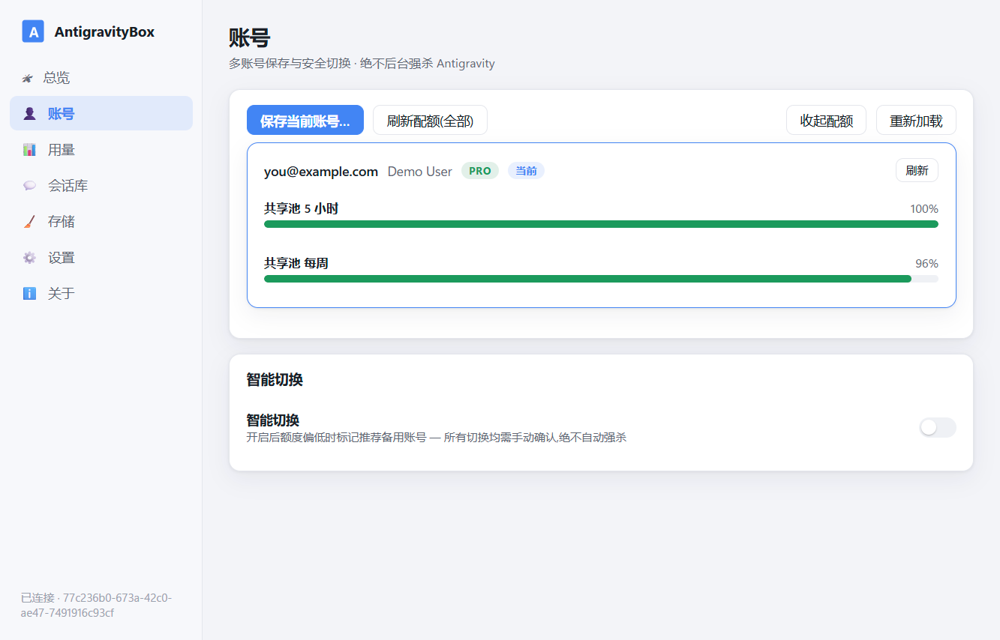
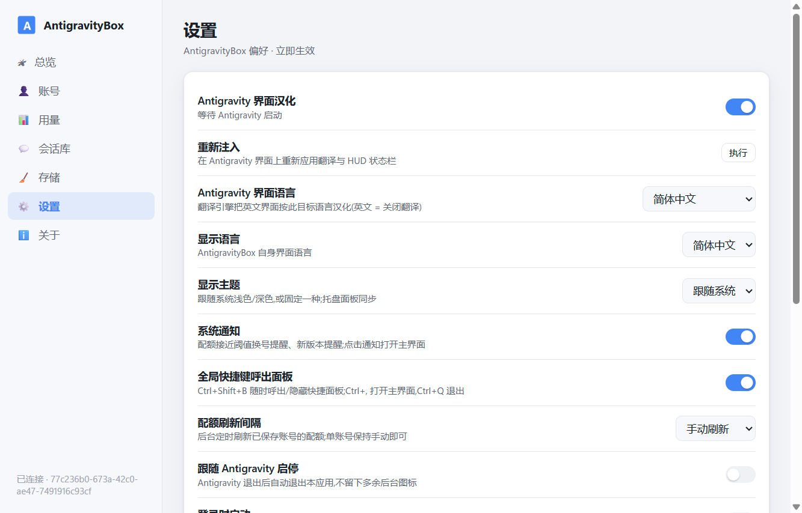

# AntigravityBox

<p align="center">
  
</p>

**A Windows desktop companion for [Google Antigravity](https://antigravity.google/) — quota overview, usage analytics, multi-account switching, UI translation & HUD, all in one local app.**

**Antigravity 的 Windows 桌面工作台**:配额总览、用量统计、多账号管理、界面汉化与对话 HUD,一站式本地伴侣应用。

<p align="center">
  <a href="#-安装-install"></a>
  
  <a href="LICENSE"></a>
  <a href="https://github.com/Enzoo404/gravitybox"></a>
</p>

---

## 📸 界面预览 · Screenshots

| 总览 · Overview | 用量 · Usage |
| --- | --- |
|  |  |

| 会话库 · Conversations | 账号 · Accounts | 设置 · Settings |
| --- | --- | --- |
|  |  |  |

## ✨ 功能 · Features

| 功能 | 说明 |
| --- | --- |
| **配额总览** | Gemini 双周期(5 小时/每周)余量条、Claude/GPT 池、独立高阶模型条、重置倒计时;今日 Token/费用/请求三联卡;**配额历史曲线**(24 小时/7 天);可配置后台自动刷新(手动/5/10/15/30/60 分钟) |
| **按模型用量** | 今日活跃模型含缓存命中%、费用占比条、计价状态;输入/输出/缓存读写**明细分解条**与**缓存节省**等效美元估算 |
| **用量账单** | 四档时间范围;**费用环图**(按模型)、平均单次 Token、**月费用预测**(按近 7 天外推)、**请求明细检索窗**(按模型搜索 + 分页)、汇总/逐条 **JSON 与 CSV(Excel 友好)导出** |
| **会话库** | 本地会话数据库**只读浏览**(文件/大小/请求数/Token/最近活动),按 ID 搜索,逐请求明细与 **Markdown 导出**;指标脱敏,不含对话内容 |
| **对话状态栏 (HUD)** | 输入框下常驻三胶囊:轮次/耗时/吐字速度、累计 Token/缓存命中、压缩徽章/上下文水位;悬停展开**对话统计**(TTFT/TPS)、**Token 用量**(缓存命中/读写/思维链拆分/估算费用/缓存节省)、**当前上下文**三张明细卡片 |
| **界面汉化** | 经 CDP 向 Antigravity 的 Isolated World 注入翻译引擎,**零修改官方安装**;**个人词典编辑器**(内置 → 增量 → 个人覆盖三层词典,保存即生效);检测到第三方补丁时自动停用注入 |
| **常驻托盘面板** | 配额/用量/账号三页签 + Token/请求维度趋势柱状图 + 模型排行;**`···` 快捷菜单**;**Ctrl+Shift+B 全局呼出** |
| **多账号** | 本地账号档案(凭据存于 Windows 凭据管理器);**智能切换**(排序策略/监测范围/触发阈值/候选准入下限,推荐备用徽章 + **低额度系统通知**);安全切换(日志+可回滚) |
| **存储维护** | 浏览器缓存/历史日志双桶聚合清理,主对话/归档树/运行树 100% 保护,回收站快照一键恢复 |
| **系统与更新** | 显示语言(跟随系统/简中/English)、**显示主题**(跟随系统/浅色/深色)、**系统通知**、快捷键(Ctrl+, 主界面 / Ctrl+Q 退出)、登录时启动、**跟随 Antigravity 启停**、**自动更新**(GitHub Releases + SHA-256 校验) |

## 📥 安装 · Install

从 [**Releases**](https://github.com/kkgace/antigravity-box/releases) 下载 `AntigravityBox-Setup-x.y.z-x64.exe`(无需安装 Node/Electron,内置运行时):

1. 下载安装包与同名 `.sha256` 校验文件
2. (推荐)校验完整性:

   ```powershell
   Get-FileHash .\AntigravityBox-Setup-0.1.0-x64.exe -Algorithm SHA256   # 与 .sha256 文件内容比对
   ```

3. 运行安装(支持自定义安装目录,写入用户目录,无需管理员权限)
4. 首次启动后应用驻留系统托盘;打开主界面即可开始使用

**系统要求**:Windows 10 / 11(x64)、已安装 Google Antigravity(配额/汉化功能需要;纯用量浏览只依赖本地会话数据库)。

### 从源码构建 · Build from source

要求 Node.js ≥ 22.15:

```powershell
npm install          # 网络受限可加 --registry=https://registry.npmmirror.com
npm run build        # tsc + 资源 staging + engine.js + ICO
npm test             # 132 项单元测试
npm start            # 启动开发版
npm run package:win  # 打包 NSIS 安装包到 release/
```

> 打包前如网络受限,设置 `ELECTRON_MIRROR=https://npmmirror.com/mirrors/electron/` 与
> `ELECTRON_BUILDER_BINARIES_MIRROR=https://npmmirror.com/mirrors/electron-builder-binaries/`。

## 🚀 快速上手

1. **配额/用量**:打开主界面即可;多账号请先在「账号」页点「保存当前账号」
2. **HUD / 汉化**:
   - 「设置」→「Antigravity 界面汉化」保持开启
   - Antigravity 默认不带调试端口,点击**「以 HUD 模式重启 Antigravity」**(先保存未保存的工作;仅命令行参数,安装本身零修改)
   - 重启后状态条变为「已注入」;检测到第三方汉化补丁时会自动停用注入并明确提示
3. **个人词典**:「设置」→「个人词典」录入英文原文与译文,保存即生效(必要时点「重新注入」)

## 🔒 隐私与安全 · Privacy & Security

- **零修改**:不 patch `app.asar`、不重签名、不向 Antigravity 注入代码;注入内容限定 Isolated World
- **最小权限**:回环 WebSocket + CDP;退出/重启 Antigravity 一律温和请求(CloseMainWindow),**绝不强杀**;切换失败自动回滚
- **凭据不外泄**:token 只在主进程使用,渲染层仅接收脱敏投影(邮箱/百分比);日志与错误信息统一脱敏
- **数据不出本机**:所有统计在本地计算;不嵌入任何遥测;唯一的外部请求是**你主动触发**的配额刷新(发给 Google)与检查更新(发给 GitHub API)
- 本项目与 Google / Antigravity 官方无任何从属关系,仅为本地伴侣工具

## 🧱 架构

```
Electron 壳(主进程 + 沙箱渲染层,contextIsolation 开启)
  ├── electron/   Backend 服务 + IPC 路由(50+ 命令)+ HUD 服务 + 通知/更新
  ├── core/       上游移植的零依赖 TypeScript 核心(账号/配额/用量/切换/维护/CDP)
  ├── windows/    Windows 适配层(凭据管理器/进程发现/回收站/PowerShell)
  ├── runtime/    CDP 注入脚本(引擎 + HUD,构建期合并为 engine.js)
  └── dict/       界面翻译词典(分层:内置 → 增量 → 个人覆盖)
```

上游对应关系:Swift/AppKit 壳 → Electron;UDS → Electron IPC;`/bin/lsof`/`/bin/ps` →
`Get-NetTCPConnection`/`Get-CimInstance`;Keychain → Windows 凭据管理器;sqlite3 CLI → `node:sqlite`。

## 🗂 数据位置

- 应用状态:`%APPDATA%\AntigravityBox\`(账号档案、用量账本、配额历史、运行时偏好、个人词典)
- 缓存:`%LOCALAPPDATA%\AntigravityBox\`
- 会话数据库:`~/.gemini/antigravity/conversations/*.db`(只读扫描,永不写入)

## 🤝 参与贡献

Issue 与 PR 均欢迎:报 bug 请附上「关于」页的 Antigravity 版本与复现步骤;功能建议请先检索已有 issue。
开发前建议阅读上方架构说明;提交前请跑 `npm test` 与 `npm run verify`。

## 📄 许可证

[MIT](LICENSE)。本项目是 [Enzoo404/gravitybox](https://github.com/Enzoo404/gravitybox)(macOS,MIT)的 Windows 移植,
核心 TypeScript 代码来自上游,归属与许可见 [THIRD_PARTY_NOTICES.md](THIRD_PARTY_NOTICES.md)。

---

*AntigravityBox is not affiliated with Google or the Antigravity team. Antigravity is a trademark of Google LLC.*
